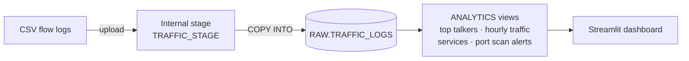

# 🌐 Network Traffic Analytics with Snowflake

Analyzing one week of network flow logs from a simulated small office network using **Snowflake**, **SQL** and **Streamlit**: finding top talkers, traffic peaks, and an automated **port scan detection** rule.


---

## 📌 Project overview

Network teams need to answer questions like *"Which devices use the most bandwidth?"*, *"When is the network busiest?"* and *"Is anything suspicious happening?"*. This project builds a small analytics pipeline to answer them:

1. **Ingest** ~29,500 connection logs (CSV) into Snowflake through an internal stage
2. **Model** the data into a `RAW` layer and an `ANALYTICS` layer of reusable views
3. **Analyze** traffic patterns with SQL
4. **Detect** suspicious behavior with a SQL-based port scan rule
5. **Visualize** everything in a Streamlit dashboard running inside Snowflake

> ℹ️ The dataset is synthetic (generated by `scripts/generate_logs.py`) to simulate a 26-device office network: servers, a backup NAS, a printer, a camera and 20 laptops. This project is for analysis and learning, not a replacement for live network monitoring tools.

## 🏗️ Architecture



| Layer | Objects | Purpose |
|---|---|---|
| `RAW` | `TRAFFIC_LOGS`, `TRAFFIC_STAGE`, `CSV_FORMAT` | Data exactly as received |
| `ANALYTICS` | `V_TOP_TALKERS`, `V_HOURLY_TRAFFIC`, `V_SERVICE_BREAKDOWN`, `V_PORT_SCAN_ALERTS` | Business-ready views for reporting |

## 🔍 Key findings

**1. Port scan detected against the database server 🚨**
`LAPTOP-13` (10.0.3.113) tried **1,024 different ports** (1–1024) on `DB-SERVER-01` (10.0.1.30) in about 4 minutes at **11:12 PM on Thursday**. The firewall denied 967 attempts. This single device produced **74% of all denied traffic**: 974 denials vs. 39 for the next device. The `V_PORT_SCAN_ALERTS` view now flags this pattern automatically.

**2. The nightly backup dominates bandwidth**
`BACKUP-NAS` moved **~150 GB, over 99% of all data**, almost entirely during a 2:00–2:30 AM backup window to the file server. Scheduling it overnight keeps it away from business hours.

**3. Clear business-hours pattern**
Weekdays average **~5,200 connections/day** vs. **~1,800 on weekends**, with daytime peaks at **10 AM and 2 PM**.

**4. HTTPS is the most common service**
HTTPS (port 443) accounts for **39%** of connections. Outside the scan, firewall denials only appear on **SSH** and **RDP**, the remote-access services a firewall policy should restrict.

## 🛠️ Tech stack & skills

- **Snowflake**: warehouses, databases, schemas, internal stages, file formats, `COPY INTO`, views
- **SQL**: aggregations, `GROUP BY` / `HAVING`, `COUNT(DISTINCT)`, `DATE_TRUNC`, conditional aggregation with `IFF`
- **Python / Streamlit**: interactive dashboard built with Streamlit in Snowflake
- **Networking**: flow logs, ports & protocols, firewall actions, port scan detection

## 📁 Repository structure

```
├── data/
│   └── network_traffic_logs.csv     # 29,489 synthetic flow records
├── images/
│   └── dashboard.png
├── scripts/
│   └── generate_logs.py             # dataset generator
├── sql/
│   ├── 01_setup.sql                 # warehouse, database, schema, table
│   ├── 02_load_data.sql             # stage + COPY INTO
│   ├── 03_exploration.sql           # exploratory analysis
│   └── 04_analytics_views.sql       # ANALYTICS layer views
└── streamlit/
    └── streamlit_app.py             # dashboard app
```

## ▶️ How to reproduce

1. Create a free [Snowflake trial account](https://signup.snowflake.com)
2. Run `sql/01_setup.sql` in a Snowsight worksheet
3. Run the first part of `sql/02_load_data.sql`, upload `data/network_traffic_logs.csv` to `TRAFFIC_STAGE`, then run the `COPY INTO`
4. Run `sql/04_analytics_views.sql`
5. Create a Streamlit app (Projects → Streamlit) in `NETWORK_ANALYTICS.ANALYTICS` and paste `streamlit/streamlit_app.py`

## 🚀 Possible next steps

- Automate ingestion with **Snowpipe** for continuously arriving logs
- Schedule alert checks with **Snowflake Tasks**
- Add more detection rules (e.g. unusual data exfiltration, traffic to unknown external IPs)
